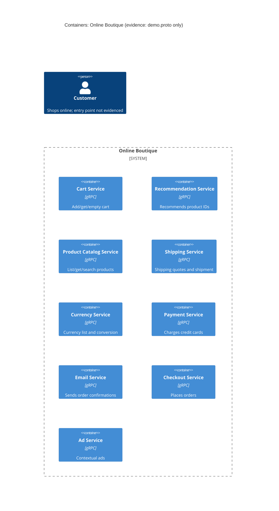

# 1A: Recovered architecture (run A)

## 1. Agent

Claude Code (Anthropic), model Claude Opus 5.5 (`claude-opus-5-5`).

## 2. Files read

- `prompts/1-recover-architecture.md` (task instructions)
- `system/online-boutique/protos/demo.proto` (the only evidence file)

## 3. Containers table

The evidence is one Protocol Buffers interface definition (`syntax = "proto3"`, `package hipstershop`). It shows each service's **interface** but not its implementation language, deployment, or callers.

| Container | Technology / language | Responsibility (from RPCs) | Evidence |
|---|---|---|---|
| Cart Service | gRPC service (proto3); language not evidenced | Add items, get a user's cart, empty a cart | `demo.proto` `service CartService` (`AddItem`, `GetCart`, `EmptyCart`) |
| Recommendation Service | gRPC service (proto3); language not evidenced | List recommended product IDs for a user and given products | `demo.proto` `service RecommendationService` (`ListRecommendations`) |
| Product Catalog Service | gRPC service (proto3); language not evidenced | List, get and search products | `demo.proto` `service ProductCatalogService` (`ListProducts`, `GetProduct`, `SearchProducts`) |
| Shipping Service | gRPC service (proto3); language not evidenced | Quote shipping cost; ship an order and return a tracking ID | `demo.proto` `service ShippingService` (`GetQuote`, `ShipOrder`) |
| Currency Service | gRPC service (proto3); language not evidenced | List supported currencies; convert `Money` between currencies | `demo.proto` `service CurrencyService` (`GetSupportedCurrencies`, `Convert`) |
| Payment Service | gRPC service (proto3); language not evidenced | Charge a credit card, return a transaction ID | `demo.proto` `service PaymentService` (`Charge`) |
| Email Service | gRPC service (proto3); language not evidenced | Send an order confirmation email | `demo.proto` `service EmailService` (`SendOrderConfirmation`) |
| Checkout Service | gRPC service (proto3); language not evidenced | Place an order, return an `OrderResult` (order ID, tracking ID, shipping cost, items) | `demo.proto` `service CheckoutService` (`PlaceOrder`) |
| Ad Service | gRPC service (proto3); language not evidenced | Return ads for page context keywords | `demo.proto` `service AdService` (`GetAds`) |

Data stores: **Not evidenced in the provided files.** No database, cache or queue appears in `demo.proto`.

Note: `option go_package` (line 19) only sets the package name for generated Go code. It does not show that any service is written in Go.

## 4. Dependencies table

| Caller → callee | Protocol | Evidence |
|---|---|---|
| None evidenced | n/a | `demo.proto` defines server interfaces only. It does not say which service calls which. |

Possible dependencies that the message types suggest (but do not prove) are listed under **Gaps**.

## 5. Mermaid diagram

There are no `Rel` lines because the evidence shows no dependencies (see section 4). The end user is included as required, but nothing in the evidence shows what they connect to.

## 6. Gaps

| Gap | Why it is open | File that would settle it |
|---|---|---|
| Who calls whom (all runtime dependencies) | The proto declares servers only; it has no client-side information | `system/online-boutique/kubernetes-manifests/*.yaml` (`*_SERVICE_ADDR` env vars); service source code (e.g. `system/online-boutique/src/checkoutservice/`) |
| **[Inferred]** Checkout Service → Cart, Product Catalog, Currency, Shipping, Payment, Email (gRPC) | `PlaceOrderRequest` carries `user_id`, `user_currency`, `Address`, `email`, `CreditCardInfo`; `OrderResult` holds `shipping_tracking_id` and `shipping_cost`. These match inputs and outputs of `GetCart`, `Convert`, `GetQuote`/`ShipOrder`, `Charge`, `SendOrderConfirmation`. Not proven. | `system/online-boutique/src/checkoutservice/` source; `kubernetes-manifests/checkoutservice.yaml` |
| User-facing entry point (web frontend / UI) | No frontend service is defined in the proto. A non-gRPC frontend would not appear here at all. | `system/online-boutique/kubernetes-manifests/frontend.yaml`; `src/frontend/` |
| Customer → system relationship and protocol (e.g. HTTP) | No user-facing interface in the evidence | Frontend manifest/source as above |
| Implementation language of each service | A proto file is language-neutral | Each `src/<service>/` folder (Dockerfile, build files) |
| Data stores (e.g. cart storage) | No storage is mentioned; Cart Service clearly keeps state per `user_id`, but where is unknown | `kubernetes-manifests/cartservice.yaml`; `src/cartservice/` |
| External systems (payment provider, email provider) | `Charge` and `SendOrderConfirmation` could be real or mocked; not shown | `src/paymentservice/`, `src/emailservice/` source |
| Deployment (ports, replicas, containers vs. one process) | Not in an interface definition | `kubernetes-manifests/` |
