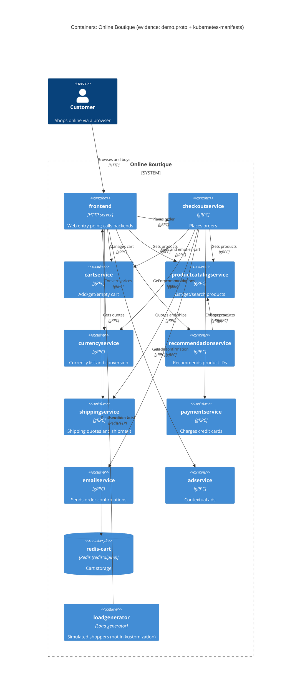

# 1B: Recovered architecture (run B)

## 1. Agent

Claude Code (Anthropic), model Claude Opus 5.5 (`claude-opus-5-5`).

## 2. Files read

- `prompts/1-recover-architecture.md` (task instructions)
- `system/online-boutique/protos/demo.proto`
- `system/online-boutique/kubernetes-manifests/README.md`
- `system/online-boutique/kubernetes-manifests/kustomization.yaml`
- `system/online-boutique/kubernetes-manifests/adservice.yaml`
- `system/online-boutique/kubernetes-manifests/cartservice.yaml`
- `system/online-boutique/kubernetes-manifests/checkoutservice.yaml`
- `system/online-boutique/kubernetes-manifests/currencyservice.yaml`
- `system/online-boutique/kubernetes-manifests/emailservice.yaml`
- `system/online-boutique/kubernetes-manifests/frontend.yaml`
- `system/online-boutique/kubernetes-manifests/loadgenerator.yaml`
- `system/online-boutique/kubernetes-manifests/paymentservice.yaml`
- `system/online-boutique/kubernetes-manifests/productcatalogservice.yaml`
- `system/online-boutique/kubernetes-manifests/recommendationservice.yaml`
- `system/online-boutique/kubernetes-manifests/shippingservice.yaml`

Paths below are shortened: `manifests/` = `system/online-boutique/kubernetes-manifests/`, `demo.proto` = `system/online-boutique/protos/demo.proto`.

## 3. Containers table

Implementation language is **not evidenced** for any service. Images are untagged local names (e.g. `image: frontend`), and the README says skaffold fills in the tags (`manifests/README.md`).

| Container | Technology / language | Responsibility | Evidence |
|---|---|---|---|
| frontend | HTTP server, port 8080; language not evidenced | Web entry point. Exposed by `frontend-external` (`type: LoadBalancer`, port 80 → 8080). Calls 8 backend addresses (7 deployed here). | `manifests/frontend.yaml` (Deployment `frontend`, `httpGet /_healthz`, Service `frontend-external`) |
| cartservice | gRPC server, port 7070; language not evidenced | Add, get and empty a user's cart (`AddItem`, `GetCart`, `EmptyCart`) | `manifests/cartservice.yaml` (Service port `name: grpc`, `grpc` probes); `demo.proto` `service CartService` |
| productcatalogservice | gRPC server, port 3550; language not evidenced | List, get and search products | `manifests/productcatalogservice.yaml`; `demo.proto` `service ProductCatalogService` |
| currencyservice | gRPC server, port 7000; language not evidenced | Supported currencies; currency conversion | `manifests/currencyservice.yaml`; `demo.proto` `service CurrencyService` |
| recommendationservice | gRPC server, port 8080; language not evidenced | Recommend product IDs | `manifests/recommendationservice.yaml`; `demo.proto` `service RecommendationService` |
| shippingservice | gRPC server, port 50051; language not evidenced | Shipping quote; ship order, return tracking ID | `manifests/shippingservice.yaml`; `demo.proto` `service ShippingService` |
| checkoutservice | gRPC server, port 5050; language not evidenced | Place an order (`PlaceOrder`), coordinating 6 backends | `manifests/checkoutservice.yaml`; `demo.proto` `service CheckoutService` |
| paymentservice | gRPC server, port 50051; language not evidenced | Charge a credit card (`Charge`) | `manifests/paymentservice.yaml`; `demo.proto` `service PaymentService` |
| emailservice | gRPC server; Service port 5000 → container 8080; language not evidenced | Send order confirmation (`SendOrderConfirmation`) | `manifests/emailservice.yaml` (Service `port: 5000`, `targetPort: 8080`); `demo.proto` `service EmailService` |
| adservice | gRPC server, port 9555; language not evidenced | Contextual ads (`GetAds`) | `manifests/adservice.yaml`; `demo.proto` `service AdService` |
| redis-cart (data store) | Redis (`image: redis:alpine`), port 6379; `emptyDir` volume at `/data` | Cart storage for `cartservice` | `manifests/cartservice.yaml` (Deployment/Service `redis-cart`, `volumes: emptyDir`) |
| loadgenerator (support) | Load generator; language not evidenced | Simulates shoppers against the frontend (`USERS: "10"`, `RATE: "1"`). **Not included** in `kustomization.yaml` (line commented out). | `manifests/loadgenerator.yaml`; `manifests/kustomization.yaml` (`# - loadgenerator.yaml`) |

## 4. Dependencies table

Protocol for the service-to-service calls: the callee's Kubernetes Service port is named `grpc` and it has `grpc` probes, and `demo.proto` defines its gRPC interface.

| Caller → callee | Protocol | Evidence |
|---|---|---|
| Customer → frontend | HTTP (port 80) | `manifests/frontend.yaml` Service `frontend-external` (`type: LoadBalancer`, port `name: http`) |
| frontend → productcatalogservice | gRPC | `manifests/frontend.yaml` (`PRODUCT_CATALOG_SERVICE_ADDR=productcatalogservice:3550`) |
| frontend → currencyservice | gRPC | `manifests/frontend.yaml` (`CURRENCY_SERVICE_ADDR=currencyservice:7000`) |
| frontend → cartservice | gRPC | `manifests/frontend.yaml` (`CART_SERVICE_ADDR=cartservice:7070`) |
| frontend → recommendationservice | gRPC | `manifests/frontend.yaml` (`RECOMMENDATION_SERVICE_ADDR=recommendationservice:8080`) |
| frontend → shippingservice | gRPC | `manifests/frontend.yaml` (`SHIPPING_SERVICE_ADDR=shippingservice:50051`) |
| frontend → checkoutservice | gRPC | `manifests/frontend.yaml` (`CHECKOUT_SERVICE_ADDR=checkoutservice:5050`) |
| frontend → adservice | gRPC | `manifests/frontend.yaml` (`AD_SERVICE_ADDR=adservice:9555`) |
| checkoutservice → productcatalogservice | gRPC | `manifests/checkoutservice.yaml` (`PRODUCT_CATALOG_SERVICE_ADDR`) |
| checkoutservice → shippingservice | gRPC | `manifests/checkoutservice.yaml` (`SHIPPING_SERVICE_ADDR`) |
| checkoutservice → paymentservice | gRPC | `manifests/checkoutservice.yaml` (`PAYMENT_SERVICE_ADDR=paymentservice:50051`) |
| checkoutservice → emailservice | gRPC | `manifests/checkoutservice.yaml` (`EMAIL_SERVICE_ADDR=emailservice:5000`) |
| checkoutservice → currencyservice | gRPC | `manifests/checkoutservice.yaml` (`CURRENCY_SERVICE_ADDR`) |
| checkoutservice → cartservice | gRPC | `manifests/checkoutservice.yaml` (`CART_SERVICE_ADDR`) |
| recommendationservice → productcatalogservice | gRPC | `manifests/recommendationservice.yaml` (`PRODUCT_CATALOG_SERVICE_ADDR`) |
| cartservice → redis-cart | Redis protocol over TCP (port 6379) | `manifests/cartservice.yaml` (`REDIS_ADDR=redis-cart:6379`; Service port `name: tcp-redis`) |
| loadgenerator → frontend | HTTP | `manifests/loadgenerator.yaml` (`FRONTEND_ADDR=frontend:80`; init container runs `wget http://${FRONTEND_ADDR}`) |

## 5. Mermaid diagram

The Rel labels (for example "Charges card") come from the RPC names in `demo.proto`. The manifests show only that a connection exists, not which RPCs each caller uses.

## 6. Gaps

| Gap | Why it is open | File that would settle it |
|---|---|---|
| `shoppingassistantservice` | `frontend.yaml` sets `SHOPPING_ASSISTANT_SERVICE_ADDR=shoppingassistantservice:80`, but no manifest in this folder deploys it, and `demo.proto` has no matching service. `kustomization.yaml` has a commented-out `shopping-assistant` component. Not in the diagram. | `system/online-boutique/kustomize/components/shopping-assistant/`; frontend source |
| Frontend use of `ENABLE_ASSISTANT` / `PACKAGING_SERVICE_URL` | Commented out in `frontend.yaml`. Optional "packaging service" over HTTP is mentioned in a comment only. | `src/frontend/` source |
| Which RPCs each caller uses (e.g. does frontend call `ShippingService.GetQuote` only?) | Env vars show a connection, not the calls made | `src/frontend/`, `src/checkoutservice/` source |
| Implementation language of each service | Images are untagged local names | `src/<service>/` Dockerfiles / build files; `skaffold.yaml` |
| Other optional data stores (Memorystore, AlloyDB, Spanner) | Listed only as commented-out kustomize components | `system/online-boutique/kustomize/components/` |
| Cart data durability | `redis-cart` uses `emptyDir`, so **[Inferred]** cart data is lost when the pod is rescheduled | Confirmed by the manifest; other overlays may differ (`kustomize/components/memorystore`) |
| External systems (real payment gateway, real email/SMTP provider) | No external address or secret is configured for `paymentservice` or `emailservice`. **[Inferred]** They may be mocks. | `src/paymentservice/`, `src/emailservice/` source |
| Network restrictions between services | No NetworkPolicy here; a `network-policies` component is commented out | `kustomize/components/network-policies/` |
| Exact images actually deployed | `README.md` says to use the `/release` manifests | `system/online-boutique/release/` |
