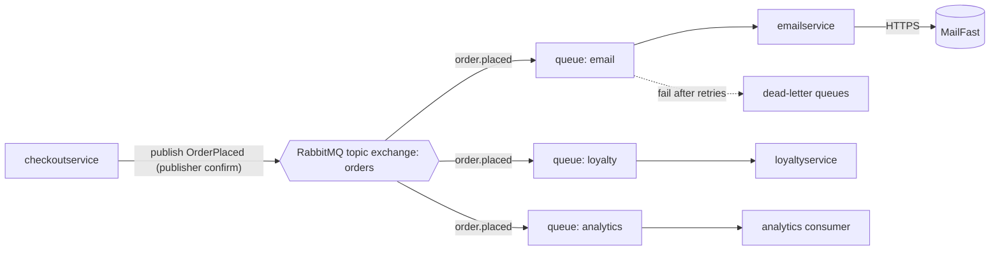

Agent: Claude Code (Anthropic), model Claude Opus 5.5 (`claude-opus-5-5`) — run 2b (with context)

# ADR-0002: Publish an "order placed" event through RabbitMQ for post-order actions

- **Status:** Proposed
- **Date:** 2026-10-25
- **Deciders:** ไม่ระบุใน context (ดู Open questions)

## Context and problem

requirement R-12 (`docs/scenario.md`) กำหนดว่าหลังสั่งซื้อสำเร็จ ระบบต้องทำ 3 อย่าง:

1. ส่งอีเมลยืนยันผ่าน **MailFast** ซึ่งเป็น external provider ที่มาแทน logic จำลองใน `emailservice`
2. ให้ **loyalty points** ผ่าน `loyaltyservice` ตัวใหม่
3. บันทึก **analytics event "order placed"** ให้ทีม marketing

นอกจากนี้ปีหน้าจะมีงานหลังสั่งซื้อเพิ่มอีก ได้แก่ SMS, fraud scoring และ recommendations update

**สภาพปัจจุบัน (จากโค้ด)**

- `checkoutservice.PlaceOrder` ทำงานตามลำดับแบบ synchronous ผ่าน gRPC: `chargeCard` → `shipOrder` → `emptyUserCart` → `sendOrderConfirmation` (`system/online-boutique/src/checkoutservice/main.go` l.252–277)
- ถ้าส่งอีเมลไม่สำเร็จ ระบบแค่ `log.Warnf` แล้ว order ก็ยังสำเร็จ (l.273–274)
- `sendOrderConfirmation` ใช้ `ctx` ของ request ต่อไปตรง ๆ และไม่ได้ตั้ง deadline เพิ่ม (l.379–383) ดังนั้น email ที่ช้าจะทำให้ `PlaceOrder` ช้าตามไปด้วย
- `checkoutservice` ไม่มี database เลย order ID สร้างจาก `uuid.NewUUID()` (l.233) และไม่ได้บันทึกที่ไหน (ใน `main.go` ไม่มี DB client)
- dependency ทุกตัวถูก inject ผ่าน env var `*_SERVICE_ADDR` (l.111–116) การเพิ่ม action แบบ synchronous จึงต้องเพิ่ม connection และแก้ `PlaceOrder` ทุกครั้ง

**ตัวเลขที่ต้องใช้ตัดสินใจ (จาก `docs/scenario.md`)**

| หัวข้อ | ข้อเท็จจริง | ผลต่อการออกแบบ |
|---|---|---|
| Checkout latency | p95 ของ `PlaceOrder` ≤ 500 ms (ปัจจุบันประมาณ 300 ms) | เหลือ headroom ประมาณ 200 ms |
| MailFast latency | p95 1.5 s, p99 8 s | เรียกแบบ synchronous ไม่ได้ เพราะ p95 ของ MailFast ตัวเดียวก็เกิน 500 ms แล้ว |
| Peak load vs rate limit | 200 orders/s ช่วง 11.11 แต่ MailFast รับได้ 50 emails/s | ช่วง peak ส่งเกิน limit อยู่ 150 emails/s จึงต้องมี buffer ซึ่งจะสะสม backlog ประมาณ 9,000 อีเมลต่อทุกนาทีที่ peak ยังไม่จบ |
| MailFast failure | ประมาณ 0.5 % ของ calls | ต้องมี retry ที่ทนต่อความล้มเหลว (ที่ 50 emails/s คือประมาณ 0.25 ครั้งต่อวินาที) |
| Loyalty | ต้องได้แต้ม **ภายใน 1 นาที** และ **exactly once** | ต้องทำ idempotency ด้วย order ID และ consumer ต้องตามทันภายใน 60 s |
| Availability | order ต้อง **ไม่ล้มเหลวเลย** เพราะ email, loyalty หรือ analytics ล่ม | action หลังสั่งซื้อต้องอยู่นอก critical path |
| Team | 4 developers ถนัด Go และ gRPC มี 2 คนเคยใช้ RabbitMQ | ควรเลือกเทคโนโลยีที่ทีมคุ้น |
| Operations | ทุกอย่างรันบน Kubernetes และบริษัทชอบ open-source แบบ self-hosted | ตัด managed cloud-only service ออก |

**ปัญหาที่ต้องตัดสินใจ:** `checkoutservice` ควร trigger action หลังสั่งซื้ออย่างไร ให้ได้ทั้ง 4 ข้อนี้พร้อมกัน

- p95 ≤ 500 ms ที่ 200 orders/s
- order ไม่ล้มเพราะ action ใดล่ม
- loyalty ภายใน 1 นาทีแบบ exactly once
- เพิ่ม action ใหม่ปีหน้าได้โดยไม่ต้องแก้ checkout ทุกครั้ง

## Decision drivers

1. **Availability:** order ต้องไม่ fail เพราะ email, loyalty หรือ analytics ล่ม (`docs/scenario.md`, Availability)
2. **Performance:** p95 `PlaceOrder` ≤ 500 ms ที่ peak 200 orders/s ทั้งที่ MailFast มี p95 1.5 s
3. **Reliability / correctness:** loyalty ภายใน 1 นาทีแบบ exactly once และอีเมลต้องส่งได้แม้ MailFast จะล้ม 0.5 % และจำกัดไว้ที่ 50 emails/s
4. **Modifiability:** เพิ่ม SMS, fraud scoring และ recommendations update ปีหน้าโดยไม่ต้องแก้และ redeploy `checkoutservice` ทุกครั้ง
5. **Operability และทักษะทีม:** ทีมเล็ก (4 คน) ถนัด Go และ gRPC มีประสบการณ์ RabbitMQ 2 คน และต้องเป็น open-source self-hosted บน Kubernetes

## Considered options

1. **Synchronous gRPC calls ใน `PlaceOrder`** (ขยายจากแบบที่ทำอยู่ตอนนี้): เรียก `emailservice` (→ MailFast), `loyaltyservice` และ analytics ต่อท้ายใน request เดียวกัน
2. **Asynchronous ภายใน process:** `checkoutservice` ยิง goroutine (fire-and-forget) เรียกแต่ละ service หลัง return ให้ลูกค้า โดยไม่มี broker
3. **Event-driven ผ่าน RabbitMQ (self-hosted):** `checkoutservice` publish `OrderPlaced` ไปที่ topic exchange แล้วให้แต่ละ action มี queue และ consumer ของตัวเอง
4. **Event-driven ผ่าน Apache Kafka (self-hosted):** แนวคิดเดียวกับข้อ 3 แต่ใช้ Kafka topic `order-placed` และ consumer group แยกต่อ action

### Pros and cons of the options

| Option | Pros | Cons |
|---|---|---|
| 1. Sync gRPC | ไม่มี infrastructure ใหม่ ทีมถนัดอยู่แล้ว debug ง่าย | **ผิด performance driver:** latency 300 ms + MailFast p95 1.5 s เกิน 500 ms และ p99 8 s จะค้าง request ไปด้วย (l.379–383 ไม่มี deadline) **ผิด throughput:** 200 orders/s > 50 emails/s จึงโดน rate limit ตลอดช่วง peak ต้องแก้ `PlaceOrder` ทุกครั้งที่เพิ่ม action (modifiability) และต้องมีโค้ดจัดการ failure ทุก call เพื่อไม่ให้ order ล้ม |
| 2. Goroutine ใน process | latency ของ checkout แทบไม่เพิ่ม ไม่มี component ใหม่ เขียนด้วย Go ได้เลย | ถ้า pod restart หรือ scale down งานที่ค้างอยู่ใน memory จะหายทั้งหมด จึงรับประกันทั้ง loyalty และ email ไม่ได้ (reliability) คุม rate limit 50 emails/s รวมทุก replica ได้ยาก ทำ exactly once ได้ยาก ยังต้องแก้ checkout ทุกครั้งที่เพิ่ม action (modifiability) และ backlog ช่วง 11.11 จะกิน memory ของ checkout |
| 3. RabbitMQ | ย้าย action ทั้งหมดออกจาก critical path เหลือแค่ publish 1 ครั้ง (performance, availability) queue ทำหน้าที่ buffer ให้ `emailservice` ทยอยส่งตามจังหวะ 50 emails/s ได้ มี retry และ dead-letter queue ในตัว (reliability) เพิ่ม action ใหม่แค่ bind queue ใหม่เข้า exchange (modifiability) open-source, self-host บน Kubernetes ได้ และทีมมีคนเคยใช้ 2 คน | เพิ่ม component แบบ stateful ที่ต้องดูแล (operability) delivery เป็น at-least-once จึงต้องทำ idempotency เอง publish เป็น call เพิ่มใน `PlaceOrder` ถ้า broker ล่มต้องเลือกระหว่างให้ order ล้ม กับยอมให้ event หาย และ checkout ไม่มี DB ให้ทำ transactional outbox |
| 4. Kafka | throughput สูงมาก เก็บ event ไว้ replay ได้ (เหมาะกับ analytics และ recommendations ในอนาคต) open-source และ self-host ได้ | operational complexity สูงกว่าสำหรับทีม 4 คน และทีมไม่มีใครมีประสบการณ์ Kafka (operability) rate limiting และ per-message retry หรือ DLQ ต้องสร้างเองมากกว่า RabbitMQ เกินความจำเป็นที่ 200 events/s ยังเป็น at-least-once และมีปัญหาเรื่อง outbox แบบเดียวกับข้อ 3 |

## Decision

เลือก **option 3: publish event `OrderPlaced` ผ่าน RabbitMQ แบบ self-hosted บน Kubernetes** โดยแต่ละ post-order action เป็น consumer อิสระ

**รายละเอียด**

- **`checkoutservice`**
  - เลิกเรียก `sendOrderConfirmation` แบบ synchronous (l.273–277)
  - หลัง `shipOrder` สำเร็จ ให้ publish `OrderPlaced` 1 ครั้ง (มี `order_id`, `user_id`, `email`, items และ total) พร้อม publisher confirm
  - ตั้ง timeout ให้อยู่ใน headroom ประมาณ 200 ms
  - ถ้า publish ไม่สำเร็จ ให้ log error แล้ว**ยังคืน order สำเร็จ** ตาม availability driver ซึ่งเป็นพฤติกรรมเดียวกับที่ทำกับ email ตอนนี้ (l.274)
- **`emailservice`**
  - เปลี่ยน mock เป็น consumer ที่เรียก MailFast
  - จำกัดอัตรารวมไม่เกิน 50 emails/s ด้วย prefetch และ rate limiter
  - retry แบบ exponential backoff สำหรับ 0.5 % ที่ล้ม เมื่อเกินจำนวนครั้งที่กำหนดให้ส่งเข้า dead-letter queue
- **`loyaltyservice`** (Go และ gRPC ตามที่ทีมถนัด)
  - consume จาก queue ของตัวเอง
  - บันทึกแต้มแบบ idempotent โดยใช้ `order_id` เป็น unique key จึงได้ผลแบบ exactly once บน at-least-once delivery
  - ต้องตามทันภายใน 1 นาทีที่ 200 orders/s
- **analytics consumer:** consume จาก queue ของตัวเอง
- **action ปีหน้า:** เพิ่ม queue ใหม่ bind เข้า exchange `orders` โดยไม่ต้องแก้ `checkoutservice`
- **RabbitMQ:** รันเป็น cluster 3 nodes ด้วย quorum queues เพื่อลดโอกาสที่ broker ล่ม

**เหตุผล**

- มีแค่ option 3 และ 4 ที่ผ่าน driver 1–4 พร้อมกัน option 1 ผิด p95 และ rate limit ส่วน option 2 ทำงานหายเมื่อ pod restart
- ระหว่าง 3 กับ 4 RabbitMQ ชนะเรื่อง operability และทักษะทีม (driver 5) มี rate limiting, retry และ DLQ ต่อ message ในตัว และ 200 events/s ก็ไม่ได้ต้องการ throughput ระดับ Kafka

## Consequences

- **Positive:** p95 ของ `PlaceOrder` ไม่ขึ้นกับ MailFast อีกต่อไป จะเพิ่มขึ้นแค่ค่า publish 1 ครั้ง ซึ่งอยู่ใน headroom 200 ms (quality attribute: performance)
- **Positive:** email, loyalty หรือ analytics ล่มแล้ว order ยังสำเร็จ และ message ยังรออยู่ใน queue จนกว่า consumer จะกลับมา (quality attribute: availability)
- **Positive:** queue รองรับ backlog ช่วง 11.11 (ส่งเกิน limit 150 emails/s) โดยไม่ละเมิด rate limit ของ MailFast (quality attribute: scalability, reliability)
- **Positive:** เพิ่ม SMS, fraud scoring และ recommendations update เป็น consumer ใหม่ได้โดยไม่ต้องแก้ checkout (quality attribute: modifiability)
- **Negative:** มี RabbitMQ cluster แบบ stateful เพิ่มมาให้ดูแล monitor และ upgrade ด้วยทีม 4 คน (quality attribute: operability, cost)
- **Negative:** อีเมลยืนยันจะถึงช้าลง ในช่วง peak อาจช้าหลายนาทีเพราะติด rate limit 50 emails/s (quality attribute: usability)
- **Negative:** consumer ทุกตัวต้อง idempotent และ schema ของ `OrderPlaced` กลายเป็นสัญญาระหว่าง service ที่ต้องทำ versioning (quality attribute: modifiability, testability)
- **Negative:** trace ของ order หนึ่งรายการกระจายไปหลาย consumer ต้อง propagate trace context ผ่าน message header ด้วย ปัจจุบัน checkout ใช้ OpenTelemetry กับ gRPC อยู่แล้ว (l.134–140) (quality attribute: observability)
- **Risks and mitigations:**
  - *RabbitMQ ล่มหรือ publish ไม่สำเร็จ จนทำให้ event หาย:* trade-off นี้ขัดกันโดยตรงระหว่าง "order ต้องไม่ fail" กับ "loyalty exactly once" ทำ transactional outbox ไม่ได้เพราะ checkout ไม่มี DB (`main.go` ไม่มี DB client) ทางลดความเสี่ยงคือ cluster 3 nodes พร้อม quorum queues, publisher confirm, retry ภายใน timeout, alert เมื่อ publish ล้ม และกำหนดวิธี reconcile ย้อนหลัง (ดู Open questions)
  - *loyalty ได้แต้มซ้ำเพราะ redelivery:* ใช้ unique constraint บน `order_id` ใน storage ของ `loyaltyservice`
  - *loyalty ช้าเกิน 1 นาทีช่วง peak:* scale consumer ของ `loyaltyservice` และ alert เมื่อ queue lag เกิน 60 s
  - *backlog อีเมลยาวมากช่วง 11.11:* monitor queue depth และ age ระยะเวลาส่งที่ยอมรับได้ยังไม่มีใน context
  - *MailFast ล้มต่อเนื่อง:* ใช้ backoff และ circuit breaker ใน `emailservice` แล้ว message ที่ล้มซ้ำไปอยู่ใน DLQ เพื่อ replay ภายหลัง

## Validation

- **Load test:** ใช้ `loadgenerator` ยิง 200 orders/s แล้วตรวจว่า p95 ของ `PlaceOrder` ≤ 500 ms
- **Loyalty SLA:** ใน load test เดียวกัน วัดเวลาตั้งแต่ order ถึงการได้แต้ม ต้อง ≤ 60 s ทุก order และนับ order ที่ได้แต้มซ้ำต้องเป็น 0
- **Rate limit:** วัดอัตราการเรียก MailFast จาก `emailservice` ต้องไม่เกิน 50/s และอีเมลทุกฉบับต้องส่งได้หรือไปอยู่ใน DLQ ในที่สุด
- **Fault injection:** ปิด `emailservice`, `loyaltyservice` และ analytics consumer ทีละตัว (และใช้ mock MailFast ที่ล้ม 0.5 % พร้อม p99 8 s) แล้วตรวจว่า order สำเร็จ 100 % และงานที่ค้างทำเสร็จหลัง service กลับมา
- **Broker failure:** kill RabbitMQ node 1 จาก 3 แล้ว order ต้องยังสำเร็จและไม่มี event หาย จากนั้นปิดทั้ง cluster เพื่อวัดว่า order ยังสำเร็จหรือไม่ และนับ event ที่หาย
- **Review date:** ทบทวน ADR นี้หลังช่วง 11.11 รอบแรก หรือเมื่อเพิ่ม post-order action ตัวแรกของปีหน้า

## Open questions

- **Deciders:** ใครเป็นผู้ตัดสินใจและอนุมัติ ADR นี้
- **RabbitMQ ล่มทั้ง cluster:** ยอมให้ event หายได้หรือไม่ ถ้าไม่ได้ ต้องเพิ่ม storage ให้ checkout เพื่อทำ outbox หรือต้องมีแหล่งข้อมูล order สำหรับ reconcile (ปัจจุบันไม่มี order store)
- **ระยะเวลา peak 11.11:** peak 200 orders/s ยาวนานเท่าไร ใช้คำนวณขนาด backlog อีเมลและ storage ของ queue
- **Email delivery target:** อีเมลยืนยันต้องถึงลูกค้าภายในกี่นาที ยอมให้ช้าได้แค่ไหนช่วง peak หรือต้องขอเพิ่ม rate limit กับ MailFast
- **MailFast API:** เป็น REST, SMTP หรือ SDK มี idempotency key ป้องกันการส่งซ้ำหรือไม่ และมีค่าใช้จ่ายต่ออีเมลเท่าไร
- **Analytics:** event ต้องไปที่ไหน (warehouse หรือเครื่องมือของ marketing) ต้องการ field อะไร และต้องการ latency หรือ exactly once หรือไม่
- **Loyalty rules:** สูตรคำนวณแต้ม และ storage ของ `loyaltyservice` (ไม่มีใน context)
- **Fraud scoring ปีหน้า:** ต้อง block order ก่อนยืนยันหรือไม่ ถ้าใช่ จะเป็น async consumer ไม่ได้ และต้องมี ADR แยก
- **Privacy:** มีข้อกำหนดเรื่องการส่ง email และข้อมูล order ให้ MailFast ซึ่งเป็น external provider หรือไม่
- **ขนาด cluster:** งบประมาณและ resource สำหรับ RabbitMQ cluster 3 nodes บน Kubernetes ที่มีอยู่
